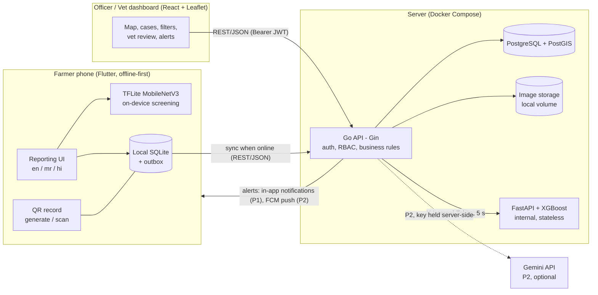
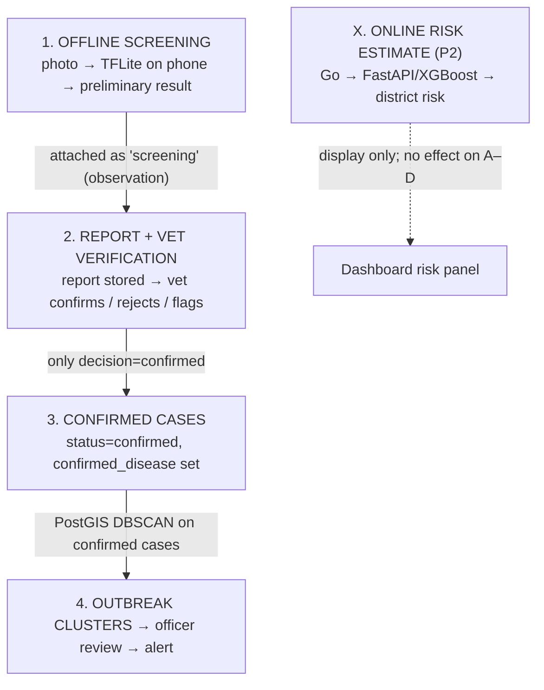
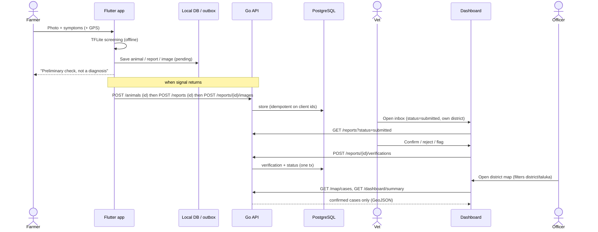

# ARCHITECTURE.md — PashuVani System Architecture

**Version:** 0.1-draft · **Status:** Pending G0/G1 · **Owner:** Om
Related: `PROJECT_CONTEXT.md` (requirements), `API_CONTRACTS.md`, `DATABASE_SCHEMA.md`, `ML_INTEGRATION.md`, `DECISIONS.md`.

---

## 1. Design principles

1. **Offline-first for the farmer.** Reporting, screening, and record-keeping work without signal; sync is automatic and retry-safe.
2. **Vet confirmation is the only source of truth for cases.** AI never creates a case. Clusters and alerts derive from confirmed cases only.
3. **One backend, one contract.** Mobile and dashboard talk only to the Go API. The ML service is internal.
4. **Smallest stack that delivers the PPT chain.** Added technologies must justify themselves (see D-12/D-13: Redis, Grafana, OpenTelemetry deferred).
5. **Human gate on warnings.** Detection suggests; an officer approves; consenting nearby farmers are alerted.
6. **Honest ML.** Screening = preliminary; risk = experimental, district-level.

## 2. Component overview

| Component | Tech | Owner | Notes |
|---|---|---|---|
| Farmer app (and vet mode, P1) | Flutter/Dart, Material 3 | Om | Drift/SQLite local DB; outbox pattern |
| On-device screening | TFLite, MobileNetV3-Small | Lokesh (model), Om (integration) | No network |
| Backend | Go, **Gin**, REST, JWT, RBAC | Om | Single binary; modular packages |
| Database | PostgreSQL 16 + PostGIS | Om | Spatial only where required (§7) |
| Image storage | Local Docker volume behind a `Storage` interface | Om | S3-compatible later (A-06) |
| Dashboard | React, TypeScript, Tailwind, Leaflet, a chart lib | Soham | Charts library chosen by Soham |
| ML service | Python, FastAPI, XGBoost | Lokesh | Internal; stateless |
| Deployment | Docker Compose on a single VM (AWS EC2 candidate) or laptop for demo | Om | See D-14 |

Gin is chosen over Fiber because it sits on `net/http` (compatible with standard middleware, OpenTelemetry/Prometheus libraries, `httptest`), has a large ecosystem, and the team's performance needs are modest (D-04).

## 3. Four distinct data flows (never mix them)

| Flow | Input | Runs on | Output | Can it create a confirmed case? |
|---|---|---|---|---|
| 1 Offline screening | Photo | Phone | `screening` JSON (label, confidence, `inconclusive`) | **No** |
| 2 Verification | Report + vet judgement | Dashboard/vet app → Go | `vet_verifications` row, report status | **Yes — the only way** |
| 3 Confirmed cases | Verified reports | Postgres | Map points, counts | (they *are* the cases) |
| 4 Clustering → alert | Confirmed cases | Go + PostGIS | `outbreaks` (suspected) → officer promotes → `alerts` → notifications | No |
| X XGBoost estimate | Aggregated features | FastAPI | `risk_predictions` (district) | **No**; no effect on flows 1–4 |

## 4. Primary end-to-end sequence (P0)

## 5. Offline data capture and synchronisation (Flutter)

- **Local store:** SQLite via Drift (candidate; Om's call, D-15) with tables mirroring `animals`, `reports`, `report_images`, plus cached reference data and an `outbox`.
- **Client-generated UUIDs** for animals, reports, images → server idempotency (`API_CONTRACTS.md` §1).
- **Outbox:** each pending operation is a row `{id, op, entity_id, status: pending|syncing|done|failed, attempts, last_error, next_attempt_at}`. A sync worker runs on app foreground, connectivity change, and a periodic timer (WorkManager/background is P2).
- **Order:** animals → reports → images (dependencies enforced by the queue). Each step retry-safe.
- **Backoff:** exponential (5 s → 5 min cap); `4xx` (except 408/429) marks the item `failed` and surfaces it to the user; `5xx`/network retries.
- **Conflict policy (v1):** farmer-owned records are **client-wins on create** (server stores what was sent); server-owned data (status, verification) is **server-wins** and is pulled by `GET /reports` refresh. No offline editing of shared state. `PATCH /animals/{id}` conflicts: last-write-wins (P1).
- **Visible state:** every pending/failed report shows a sync badge; farmers can retry manually.
- **Auth offline:** access token expiry does not block local use; refresh occurs on reconnect. Offline login is **not** supported (user must have logged in once).
- **Reference data:** locations, species, breeds, diseases, symptoms cached with ETag; first launch requires connectivity (or a bundled seed; Om decides).
- **Stale data:** QR/offline records always show `snapshot_at`.
- **Images:** downscaled on device (long edge ≤ 1600 px) before queuing.

## 6. Authentication and authorisation

- Phone + password → JWT access (60 min) + rotating opaque refresh token (30 days, hashed in DB). See `API_CONTRACTS.md` §3.
- RBAC middleware in Go: role from token, **scope loaded from DB** (vet/officer district). Every handler declares required roles; every query applies scope filters in SQL.
- Farmers self-register; vets/officers/admins are created by an admin or seed script.
- Dashboard login uses the same endpoints; `farmer` role is rejected by the dashboard UI (and by endpoints it doesn't permit).
- ML service: network-private + `X-Internal-Token`. Never exposed to the internet or apps.
- Details and threat model: `SECURITY.md`.

## 7. Geospatial surveillance

- Stored points are `geography(Point,4326)`; GiST indexes (`DATABASE_SCHEMA.md` §5).
- **Map:** confirmed reports only, filtered by declared district/taluka ids.
- **Clustering (P1):** Go job runs `ST_ClusterDBSCAN` (eps 5 km, minpoints 3, 14-day window; **placeholder parameters**, A-04) per surveillance disease over confirmed cases with GPS location, in EPSG:32643 (valid for the Satara pilot). Output upserts `outbreaks` (`suspected`) + `outbreak_cases`. Triggered after each verification (debounced) and every 15 minutes.
- **Alert targeting:** `ST_DWithin` on consenting farmers' `farm_location` within the alert radius of the outbreak/alert centre.
- **Not used:** polygons, raster, routing. Admin hierarchy is a plain parent/child table. The research references in the PPT (scan statistics [11]) are future work, not P0/P1.

## 8. Notifications and alert delivery

1. Cluster detected → `outbreaks.status = suspected` (visible to officer on dashboard).
2. Officer reviews, promotes to `active` (human gate), drafts an alert (`POST /alerts`), sends it (`POST /alerts/{id}/send`).
3. Go inserts one `notifications` row per consenting farmer in radius (idempotent per alert/user).
4. **P1 delivery:** the Flutter app polls `GET /notifications` (on foreground + every few minutes) and shows an in-app banner/list.
5. **P2 delivery:** FCM push (device tokens) and SMS provider (budget line "SMS and alerts"); neither is required for the demo (D-09).
6. Alert text must state the warning is based on vet-confirmed cases nearby and must not name or locate individual farms.
7. Report-status updates (`report_update`) notify the farmer after a vet decision.

## 9. ML integration summary

Detailed in `ML_INTEGRATION.md`. In short: the Flutter app loads an artifact bundle (`model.tflite`, `labels.json`, `manifest.json`) shipped in app assets; inference is local. Go calls FastAPI only for the P2 district risk estimate; failures degrade gracefully and never block reporting.

## 10. Backend structure (Go, modular monolith)

Planned packages (names indicative; implementation is Om's, after G1):
`cmd/api`, `internal/{config,http (router, middleware, handlers), auth, users, locations, animals, reports, verification, map, dashboard, outbreaks, alerts, notifications, risk, storage, platform/db}`, `migrations/`. Handlers → services → repositories (SQL via `pgx`; query layer choice is Om's). No microservices.

## 11. Deployment and observability

- **Environments:** `local` (Compose on laptops), `demo` (single VM or the lead's laptop with a tunnel). `docker compose up` brings up Postgres/PostGIS, API, ML service (optional profile), dashboard static build.
- **Config:** environment variables only; `.env.example` committed, `.env` never.
- **Minimum observability (P0):** structured JSON logs with `request_id`, `/healthz` and readiness.
- **P2:** Prometheus `/metrics` endpoint and a Grafana dashboard; OpenTelemetry tracing only if time remains (D-13). Redis is **not** included (no caching/queue need identified — D-12).
- **Backups (demo):** `pg_dump` script; no HA.

## 12. Non-functional targets (stated, measured later — not claimed)

| Concern | Target |
|---|---|
| API p95 latency (list/map endpoints, demo data) | < 500 ms (to be measured) |
| Image upload | ≤ 5 MB, resumable by retry |
| Offline | Reports + screening work with airplane mode on |
| Accessibility | Large touch targets, Marathi UI, icon-supported flows for low literacy |
| Privacy | Consent before alerts; no farmer identity in alerts/map properties |

## 13. Known limitations (documented, not hidden)

- District/taluka assignment is by declared village, not GPS polygon (D-08).
- EPSG:32643 clustering is valid for the pilot region only (D-07).
- Cluster/alert criteria are placeholders pending veterinary input (A-04, M-03).
- No labelled field dataset exists yet (C-07); screening quality is unproven.
- XGBoost may produce no usable model (C-08).
- Offline login unsupported; first launch needs connectivity.
- Single-VM deployment; no HA/backups beyond dumps.

