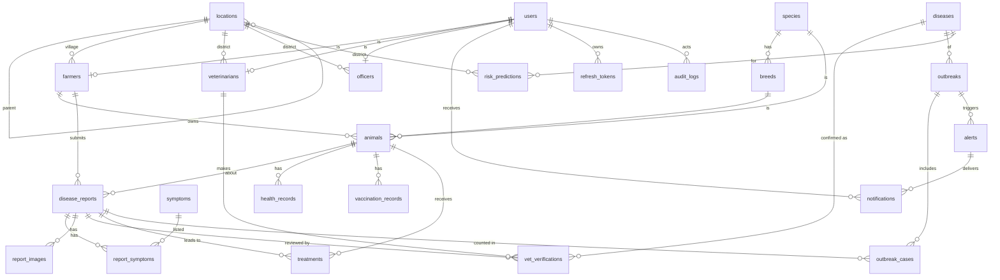

# DATABASE_SCHEMA.md — PashuVani Database Design

**Version:** 0.1-draft · **Status:** NOT FROZEN (needs Gate G1) · **Owner:** Om · **Consumers:** Om (Go), Lokesh (feature extraction/reference), Soham (indirectly via API)
**Engine:** PostgreSQL 16 + PostGIS 3. **No migrations exist yet** — this is a design document, not DDL.

> Soham and Lokesh do **not** query the database directly. Soham uses the API only. Lokesh's FastAPI service is stateless and receives features from Go (see `ML_INTEGRATION.md` §3).

---

## 1. Conventions

| Topic | Rule |
|---|---|
| Primary keys | `uuid`. Client-generated (UUIDv4) for entities created offline: `animals`, `disease_reports`, `report_images`. Server-generated (`gen_random_uuid()`) for the rest. |
| Timestamps | `timestamptz`, stored UTC. `created_at`/`updated_at` on every mutable table. `updated_at` maintained by trigger or app code (Om decides at implementation). |
| Naming | `snake_case`, plural table names, `<table_singular>_id` FKs. |
| Enums | Postgres `CREATE TYPE ... AS ENUM` for stable sets listed in §3. Catalogs that medical advisors may edit (diseases, symptoms, breeds) are **tables with a stable `code`**, not enums. |
| Soft delete | Not used. Use `is_active` flags where deactivation is needed. Health data is never hard-deleted by the API. |
| Geospatial | `geography(Point,4326)` for stored points (distance in meters, GiST index). `geometry` only inside clustering queries (transformed to EPSG:32643). Coordinates in API JSON are `{lat,lng}`; PostGIS functions take `(lng,lat)` — **do not swap**. |
| Text lengths | Enforced by `CHECK (char_length(...) <= n)`. |
| Codes | `code` columns: `^[a-z0-9_]{2,64}$`, unique, immutable once published. |
| Money/PII | No payment data. PII = phone, name, farm location; see `SECURITY.md`. |

## 2. Entity-relationship overview



## 3. Enum types

| Enum | Values |
|---|---|
| `user_role` | `farmer`, `vet`, `officer`, `admin` |
| `language_code` | `en`, `hi`, `mr` |
| `location_level` | `state`, `district`, `taluka`, `village` |
| `officer_level` | `district`, `state` |
| `animal_sex` | `male`, `female`, `unknown` |
| `report_status` | `submitted`, `under_review`, `confirmed`, `rejected`, `flagged` |
| `verification_decision` | `confirmed`, `rejected`, `flagged` |
| `location_source` | `gps`, `village_centroid` |
| `health_record_type` | `observation`, `checkup`, `weight`, `note` |
| `outbreak_status` | `suspected`, `active`, `resolved`, `dismissed` |
| `alert_status` | `draft`, `sent`, `cancelled` |
| `notification_type` | `alert`, `report_update`, `system` |
| `risk_band` | `low`, `medium`, `high` |

Report status transitions (enforced in Go, one transaction with the verification insert):

```
submitted ──► confirmed | rejected | flagged            (vet decision)
submitted ──► under_review ──► confirmed|rejected|flagged  (P1: vet claims the report)
flagged   ──► confirmed | rejected                      (re-review)
confirmed ──► rejected | flagged                        (vet corrects an earlier decision; outbreaks recomputed)
rejected  ──► confirmed | flagged                       (vet corrects)
```

## 4. Tables

Legend: **PK** primary key · **FK** foreign key · **UQ** unique · **NN** not null. Priority `P0/P1/P2` indicates when the table is first needed.

### 4.1 `users` — P0
Authentication identity for every human.

| Column | Type | Constraints |
|---|---|---|
| `id` | uuid | PK, default `gen_random_uuid()` |
| `phone` | text | NN, UQ, `CHECK (phone ~ '^\+91[6-9][0-9]{9}$')` (E.164, India) |
| `password_hash` | text | NN (bcrypt/argon2id) |
| `full_name` | text | NN, `CHECK (char_length(full_name) BETWEEN 2 AND 100)` |
| `role` | user_role | NN |
| `preferred_language` | language_code | NN, default `'mr'` |
| `is_active` | boolean | NN, default true |
| `last_login_at` | timestamptz | |
| `created_at`, `updated_at` | timestamptz | NN, default `now()` |

Indexes: UQ(`phone`); idx(`role`).
Rule: a user has exactly one profile row matching `role` (farmers/veterinarians/officers); `admin` has none. Enforced in service layer.

### 4.2 `locations` — P0
Administrative hierarchy state → district → taluka → village (single adjacency table; **no polygons** in P0, see D-08).

| Column | Type | Constraints |
|---|---|---|
| `id` | uuid | PK |
| `level` | location_level | NN |
| `parent_id` | uuid | FK → `locations(id)`; NULL only for `state`; `CHECK ((level='state') = (parent_id IS NULL))` |
| `name_en`, `name_mr` | text | NN |
| `name_hi` | text | |
| `lgd_code` | text | UQ per level (Local Government Directory code, if available — M-05) |
| `centroid` | geography(Point,4326) | NN for `village`, optional otherwise |
| `created_at` | timestamptz | NN |

Indexes: idx(`parent_id`), idx(`level`), GiST(`centroid`), UQ(`level`,`lgd_code`) where `lgd_code` not null.
Seed (P0): Maharashtra → Satara district → talukas (at least Phaltan, Satara, Koregaon, Khandala…) → a handful of villages near Phaltan. Source of the data is **not yet decided** (M-05); if no official data is obtained, a hand-entered, clearly-labelled demo seed is used.

### 4.3 `farmers` — P0

| Column | Type | Constraints |
|---|---|---|
| `user_id` | uuid | PK, FK → `users(id)` ON DELETE CASCADE |
| `village_id` | uuid | NN, FK → `locations(id)` (level must be `village`; trigger/app check) |
| `farm_name` | text | `CHECK (char_length <= 100)` |
| `farm_location` | geography(Point,4326) | Used for alert targeting; NULL until captured |
| `alert_consent` | boolean | NN, default **false** |
| `alert_consent_at` | timestamptz | set when consent changes to true |
| `created_at`, `updated_at` | timestamptz | NN |

Indexes: idx(`village_id`), GiST(`farm_location`) partial `WHERE alert_consent`.

### 4.4 `veterinarians` — P0

| Column | Type | Constraints |
|---|---|---|
| `user_id` | uuid | PK, FK → `users(id)` ON DELETE CASCADE |
| `district_id` | uuid | NN, FK → `locations(id)` (level `district`) — the vet's review scope |
| `registration_number` | text | NN, UQ (state veterinary council no.) |
| `is_para_vet` | boolean | NN, default false (policy for para-vets confirming is open: M-06) |
| `clinic_name` | text | |
| `created_at`, `updated_at` | timestamptz | NN |

Indexes: idx(`district_id`).

### 4.5 `officers` — P0

| Column | Type | Constraints |
|---|---|---|
| `user_id` | uuid | PK, FK → `users(id)` ON DELETE CASCADE |
| `level` | officer_level | NN |
| `district_id` | uuid | FK → `locations(id)`; `CHECK ((level='district') = (district_id IS NOT NULL))` |
| `designation` | text | |
| `created_at`, `updated_at` | timestamptz | NN |

### 4.6 `species`, `breeds` — P0 (seed catalogs)

`species`: `id` uuid PK · `code` text UQ NN (`cattle`, `buffalo`) · `name_en`, `name_mr`, `name_hi` NN.
`breeds`: `id` uuid PK · `species_id` FK → `species(id)` NN · `code` text NN · `name_en`, `name_mr`, `name_hi` · UQ(`species_id`,`code`) · idx(`species_id`).
Seed content is proposed (e.g. Gir, Holstein Friesian cross, Jersey cross, Khillar, Deoni, Murrah for buffalo). A vet advisor should review (A-05).

### 4.7 `animals` — P0

| Column | Type | Constraints |
|---|---|---|
| `id` | uuid | PK (client-generated allowed) |
| `farmer_id` | uuid | NN, FK → `farmers(user_id)` |
| `species_id` | uuid | NN, FK → `species(id)` |
| `breed_id` | uuid | FK → `breeds(id)`; must belong to `species_id` (app check) |
| `name` | text | `CHECK (char_length <= 60)` |
| `tag_number` | text | Ear tag / Bharat Pashudhan ID if known (M-08). UQ where not null |
| `sex` | animal_sex | NN, default `unknown` |
| `birth_date` | date | approximate allowed; `CHECK (birth_date <= current_date)` |
| `markings` | text | free text, ≤ 200 |
| `qr_secret` | bytea | NN, random 16 bytes; never exposed; used for QR signing (P1) |
| `is_active` | boolean | NN, default true |
| `created_at`, `updated_at` | timestamptz | NN |

Indexes: idx(`farmer_id`), UQ(`tag_number`) partial, idx(`species_id`).

### 4.8 `diseases` — P0 (seed catalog)

| Column | Type | Constraints |
|---|---|---|
| `id` | uuid | PK |
| `code` | text | NN, UQ (e.g. `lumpy_skin_disease`, `foot_and_mouth_disease`) |
| `name_en`, `name_mr` | text | NN |
| `name_hi` | text | |
| `is_surveillance` | boolean | NN, default false — only these participate in clustering/alerts |
| `species_ids` | uuid[] | species affected (informational) |
| `is_active` | boolean | NN, default true |

Seed: **proposed, unreviewed** list. The PPT names only LSD (and context FMD and brucellosis in NADCP). Final list: Q-01.
The MobileNetV3 label → disease mapping lives in the ML manifest (`ML_INTEGRATION.md` §2.5), not in this table.

### 4.9 `symptoms` — P0 (seed catalog)

`id` uuid PK · `code` text UQ NN (e.g. `skin_nodules`, `fever`, `reduced_milk`, `lameness`, `nasal_discharge`, `salivation`, `loss_of_appetite`) · `name_en`, `name_mr` NN · `name_hi` · `is_active`.

### 4.10 `disease_reports` — P0 (core table)

| Column | Type | Constraints |
|---|---|---|
| `id` | uuid | PK (client-generated; idempotency key) |
| `animal_id` | uuid | NN, FK → `animals(id)` |
| `farmer_id` | uuid | NN, FK → `farmers(user_id)` (denormalised from animal; must equal `animals.farmer_id`) |
| `reported_at` | timestamptz | NN — device time when farmer filed it; `CHECK (reported_at <= now() + interval '10 minutes')` |
| `received_at` | timestamptz | NN, default `now()` — server time (sync latency = `received_at - reported_at`) |
| `description` | text | `CHECK (char_length <= 2000)` |
| `description_language` | language_code | |
| `location` | geography(Point,4326) | nullable |
| `location_accuracy_m` | real | `CHECK (>= 0)` |
| `location_source` | location_source | NN when `location` set |
| `village_id` | uuid | FK → `locations(id)`; defaults to farmer's village |
| `taluka_id`, `district_id` | uuid | NN, FK → `locations(id)`; **set by server from `village_id`**, used for filtering |
| `status` | report_status | NN, default `submitted` |
| `confirmed_disease_id` | uuid | FK → `diseases(id)`; set only while `status='confirmed'`; `CHECK ((status='confirmed') = (confirmed_disease_id IS NOT NULL))` |
| `confirmed_at` | timestamptz | when current verification was `confirmed` |
| `screening_model_version` | text | e.g. `mnv3s-2026.11.0`; NULL if no screening |
| `screening_top_label` | text | label code from manifest |
| `screening_top_confidence` | real | `CHECK (BETWEEN 0 AND 1)` |
| `screening_inconclusive` | boolean | |
| `screening_scores` | jsonb | `[{"label":"...","score":0.0}]` |
| `screening_ran_at` | timestamptz | |
| `created_at`, `updated_at` | timestamptz | NN |

Constraints: `CHECK (location IS NOT NULL OR village_id IS NOT NULL)`.
Indexes: idx(`farmer_id`,`reported_at` desc), idx(`animal_id`), idx(`district_id`,`status`,`reported_at` desc), idx(`taluka_id`,`status`), GiST(`location`) partial `WHERE status='confirmed'`, idx(`confirmed_disease_id`,`confirmed_at`) partial `WHERE status='confirmed'`.
> Screening columns are **observations**, never a diagnosis. Nothing derived from them may trigger an alert.

### 4.11 `report_symptoms` — P0
`report_id` FK → `disease_reports(id)` ON DELETE CASCADE · `symptom_id` FK → `symptoms(id)` · **PK**(`report_id`,`symptom_id`) · idx(`symptom_id`).

### 4.12 `report_images` — P0

| Column | Type | Constraints |
|---|---|---|
| `id` | uuid | PK (client-generated) |
| `report_id` | uuid | NN, FK → `disease_reports(id)` ON DELETE CASCADE |
| `storage_key` | text | NN, UQ (path/key inside storage backend) |
| `mime_type` | text | NN, `CHECK (mime_type IN ('image/jpeg','image/png','image/webp'))` |
| `size_bytes` | integer | NN, `CHECK (size_bytes BETWEEN 1 AND 5242880)` |
| `width`, `height` | integer | NN |
| `sha256` | text | NN, hex(64) |
| `created_at` | timestamptz | NN |

Indexes: idx(`report_id`). Rule: ≤ 4 images per report (service layer).

### 4.13 `vet_verifications` — P0 (append-only history)

| Column | Type | Constraints |
|---|---|---|
| `id` | uuid | PK |
| `report_id` | uuid | NN, FK → `disease_reports(id)` |
| `vet_id` | uuid | NN, FK → `veterinarians(user_id)` |
| `decision` | verification_decision | NN |
| `disease_id` | uuid | FK → `diseases(id)`; `CHECK ((decision='confirmed') = (disease_id IS NOT NULL))` |
| `notes` | text | `CHECK (char_length <= 2000)`; required (non-empty) when decision ≠ `confirmed` |
| `visit_required` | boolean | NN, default false |
| `is_current` | boolean | NN, default true |
| `created_at` | timestamptz | NN |

Indexes: **UQ**(`report_id`) `WHERE is_current` (exactly one current verification per report), idx(`vet_id`,`created_at` desc).
Rows are never updated except flipping `is_current` to false when a newer one is inserted; never deleted.
Hard rule: `disease_reports.status`/`confirmed_disease_id` always mirror the current verification (or `submitted`/`under_review` if none).

### 4.14 `health_records` — P1
`id` PK · `animal_id` FK NN · `record_type` health_record_type NN · `recorded_by` FK → `users(id)` NN · `recorded_at` timestamptz NN · `summary` text NN ≤ 500 · `data` jsonb (e.g. `{"weight_kg":310}`) · `created_at`. idx(`animal_id`,`recorded_at` desc).

### 4.15 `vaccination_records` — P1
`id` PK · `animal_id` FK NN · `disease_id` FK → `diseases(id)` (nullable) · `vaccine_name` text NN ≤ 100 · `administered_on` date NN (`<= current_date`) · `next_due_on` date (`>= administered_on`) · `batch_number` text · `administered_by` FK → `users(id)` · `created_at`. idx(`animal_id`,`administered_on` desc), idx(`next_due_on`).

### 4.16 `treatments` — P1
`id` PK · `animal_id` FK NN · `report_id` FK → `disease_reports(id)` (nullable) · `vet_id` FK → `veterinarians(user_id)` NN · `treatment_name` text NN ≤ 200 · `dosage` text · `started_on` date NN · `ended_on` date (`>= started_on`) · `notes` text ≤ 1000 · `created_at`. idx(`animal_id`), idx(`report_id`).

### 4.17 `outbreaks` — P1 (derived from confirmed cases)

| Column | Type | Constraints |
|---|---|---|
| `id` | uuid | PK |
| `disease_id` | uuid | NN, FK → `diseases(id)`; the disease must have `is_surveillance = true` |
| `district_id` | uuid | NN, FK → `locations(id)` (majority/first case district) |
| `status` | outbreak_status | NN, default `suspected` |
| `centroid` | geography(Point,4326) | NN |
| `radius_m` | integer | NN, `CHECK (> 0)` — max distance from centroid to a member case |
| `case_count` | integer | NN, `CHECK (>= 1)` |
| `first_case_at`, `last_case_at` | timestamptz | NN (from `confirmed_at`) |
| `rule_version` | text | NN — clustering rule used (e.g. `dbscan-5km-3cases-14d`) |
| `reviewed_by` | uuid | FK → `users(id)` — officer who promoted/dismissed |
| `reviewed_at` | timestamptz | |
| `detected_at`, `updated_at` | timestamptz | NN |

Indexes: idx(`district_id`,`status`), idx(`disease_id`,`status`), GiST(`centroid`).
Only `suspected`/`active` outbreaks are recomputed; `resolved`/`dismissed` are frozen (new clusters create new rows).

### 4.18 `outbreak_cases` — P1
`outbreak_id` FK → `outbreaks(id)` ON DELETE CASCADE · `report_id` FK → `disease_reports(id)` · **PK**(`outbreak_id`,`report_id`) · idx(`report_id`). Only reports with `status='confirmed'` may be members (app + recompute enforces).

### 4.19 `alerts` — P1

| Column | Type | Constraints |
|---|---|---|
| `id` | uuid | PK |
| `outbreak_id` | uuid | NN, FK → `outbreaks(id)` |
| `created_by` | uuid | NN, FK → `officers(user_id)` |
| `title` | text | NN ≤ 120 |
| `message` | text | NN ≤ 1000 |
| `center` | geography(Point,4326) | NN (defaults to outbreak centroid) |
| `radius_m` | integer | NN, `CHECK (BETWEEN 500 AND 25000)` |
| `status` | alert_status | NN, default `draft` |
| `sent_at` | timestamptz | |
| `recipient_count` | integer | NN, default 0 |
| `created_at` | timestamptz | NN |

Rule: may move to `sent` only if the outbreak is `active` and ≥ 1 member case is currently `confirmed`. Recipients: farmers with `alert_consent = true` and `farm_location` within `radius_m` of `center` (`ST_DWithin`).

### 4.20 `notifications` — P1
`id` PK · `user_id` FK → `users(id)` NN · `type` notification_type NN · `alert_id` FK → `alerts(id)` (nullable) · `title` text NN · `body` text NN · `data` jsonb · `read_at` timestamptz · `created_at` NN. idx(`user_id`,`created_at` desc), idx(`user_id`) partial `WHERE read_at IS NULL`. UQ(`user_id`,`alert_id`) partial `WHERE alert_id IS NOT NULL` (no duplicate alert per user).

### 4.21 `risk_predictions` — P2
Stored output of XGBoost experiment (district-level only; C-08).

| Column | Type | Constraints |
|---|---|---|
| `id` | uuid | PK |
| `district_id` | uuid | NN, FK → `locations(id)` (level `district`) |
| `disease_id` | uuid | NN, FK → `diseases(id)` |
| `as_of_date` | date | NN |
| `horizon_days` | integer | NN, `CHECK (> 0)` |
| `risk_score` | numeric(5,4) | NN, `CHECK (BETWEEN 0 AND 1)` |
| `risk_band` | risk_band | NN |
| `model_version` | text | NN |
| `feature_schema_version` | text | NN |
| `missing_features` | text[] | NN, default `{}` |
| `generated_at` | timestamptz | NN |

UQ(`district_id`,`disease_id`,`as_of_date`,`horizon_days`,`model_version`). idx(`as_of_date` desc).
There is **no** `taluka_id` column by design.

### 4.22 `refresh_tokens` — P0
`id` PK · `user_id` FK NN ON DELETE CASCADE · `token_hash` text NN UQ (SHA-256 of opaque token) · `expires_at` NN · `revoked_at` · `replaced_by` uuid · `created_at` NN. idx(`user_id`).

### 4.23 `audit_logs` — P1
`id` bigserial PK · `actor_user_id` FK → `users(id)` · `action` text NN (e.g. `verification.create`, `alert.send`, `outbreak.review`, `auth.login_failed`) · `entity_type` text · `entity_id` uuid · `metadata` jsonb (no secrets/PII beyond ids) · `ip` inet · `created_at` NN. idx(`entity_type`,`entity_id`), idx(`created_at`).

### 4.24 `device_tokens` — P2 (FCM)
`id` PK · `user_id` FK NN · `token` text NN UQ · `platform` text CHECK IN (`android`,`ios`) · `created_at`, `last_seen_at`.

## 5. Spatial design

| Need | Approach |
|---|---|
| Map of confirmed cases | `disease_reports.location` filtered by `status='confirmed'` + district/taluka ids |
| Alert recipients | `ST_DWithin(farmers.farm_location, alerts.center, radius_m)` (geography → meters) |
| Outbreak clustering | `ST_ClusterDBSCAN(ST_Transform(location::geometry, 32643), eps := 5000, minpoints := 3) OVER (PARTITION BY confirmed_disease_id)` over confirmed cases within the last 14 days. **EPSG:32643 (UTM 43N) is valid for the Satara pilot only**; revisit before other regions (D-07). Parameters are stored as `rule_version` and are placeholders (A-04). |
| District/taluka filtering | Declared hierarchy ids on each report — **not** point-in-polygon (D-08). Known limitation: a case reported by GPS outside the farmer's declared district keeps the farmer's/declared village's district. |
| Reports without GPS | `location_source='village_centroid'` uses village centroid; excluded from clustering unless Om decides otherwise (flagged in API as `location.source`). |

## 6. Seed data policy

- Catalogs (`species`, `breeds`, `diseases`, `symptoms`, `locations` subset) are loaded by a seed command (Om). Proposed content is explicitly *proposed*; replacing it requires a Change Request, not a code edit.
- Demo users (1 farmer, 1 vet, 1 district officer, 1 admin) and demo reports are **synthetic**, and demo data is flagged by a `demo_` prefix in `full_name`/`name`.
- No scraped or real farmer data is ever committed.

## 7. Change control

- Schema changes during build go through `docs/change-requests/` (see `TEAM_WORKFLOW.md` §6). Additive changes (new nullable column/table) may be approved by Om alone after notifying consumers; **renames, removals, and enum changes** need the affected consumer's approval.
- Once frozen, Om is the only person who may add migration files.

## 8. Open items

| ID | Item |
|---|---|
| DB-1 | Final disease list and surveillance flags (Q-01, A-05). |
| DB-2 | Source for `locations` data (M-05). |
| DB-3 | Whether `village_centroid`-sourced cases join clusters. |
| DB-4 | Retention period of images and reports (M-compliance, SECURITY.md §7). |

