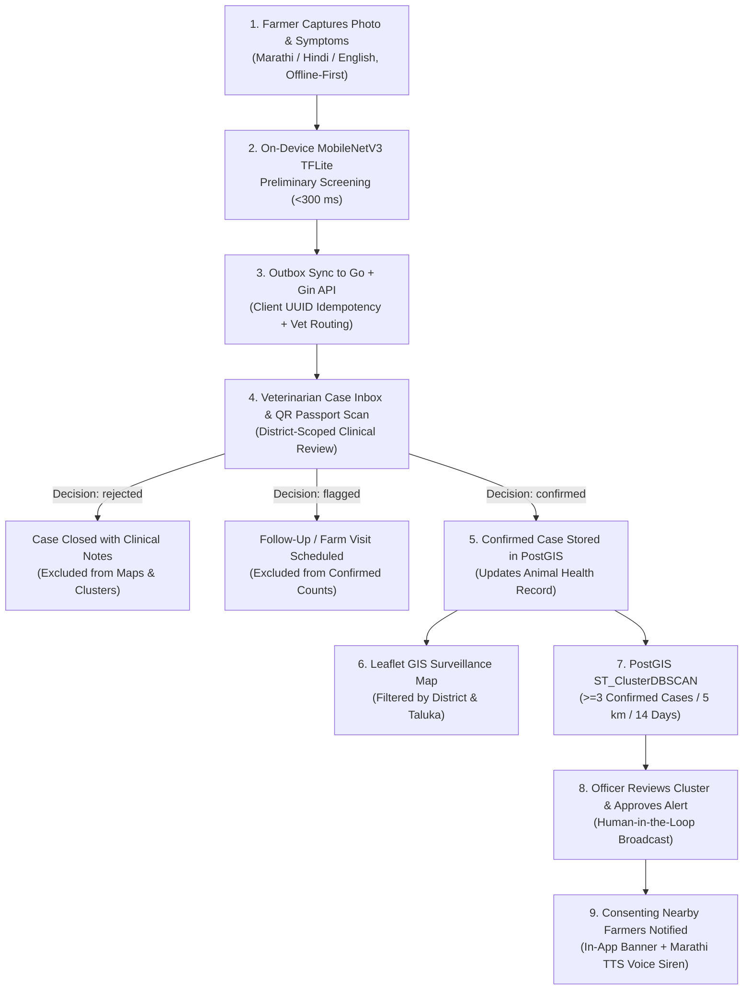
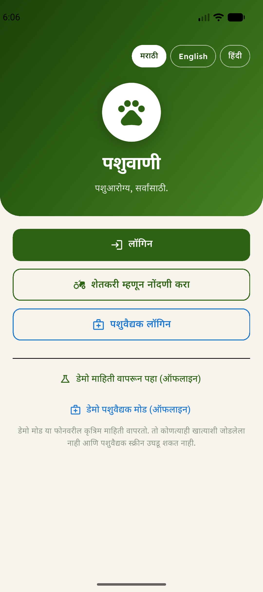
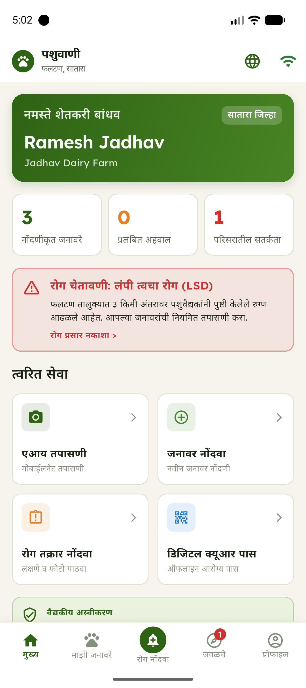
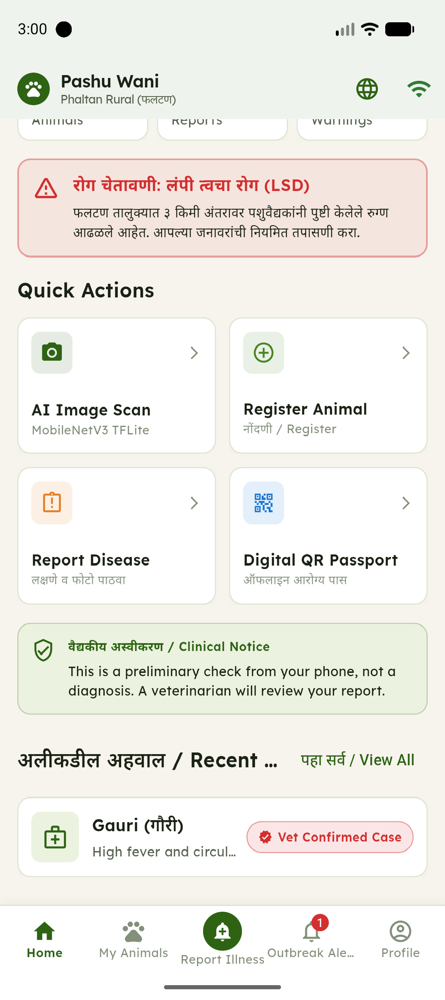
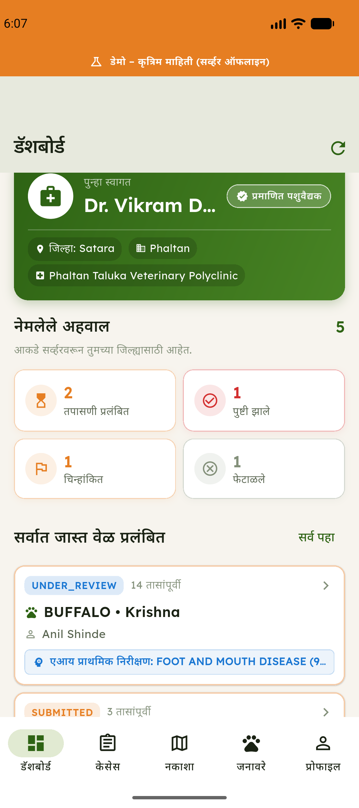
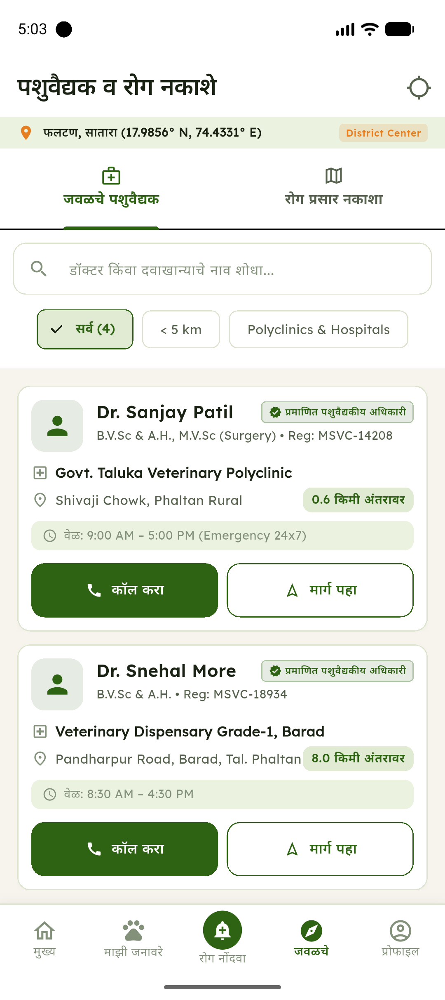
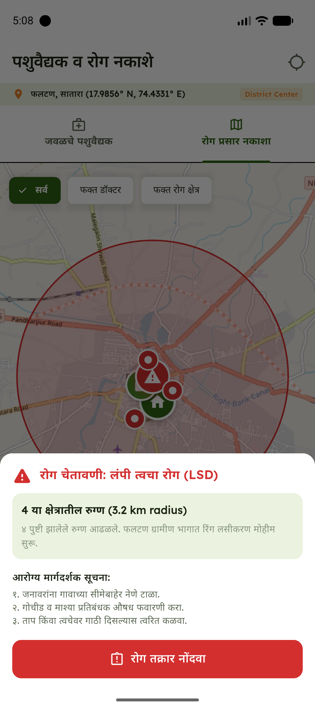
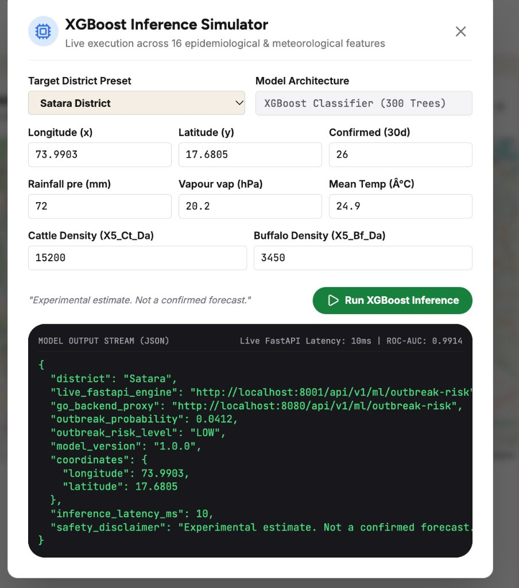
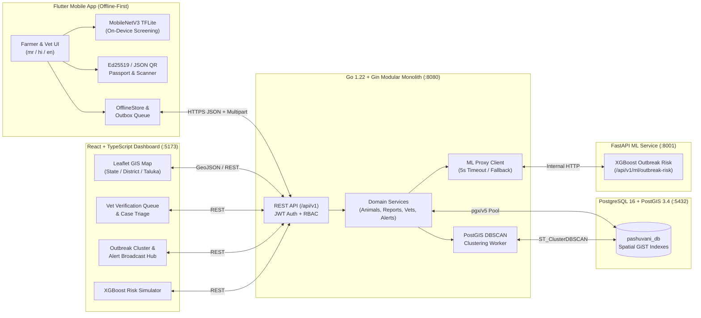

<div align="center">


# PashuVani (पशुवाणी)

### **PashuArogya, Sarvansathi — Rural Livestock Healthcare, Vet-Verified Disease Surveillance & Offline Digital Health Passports**

[](mobile/)
[](backend/)
[](docs/architecture/DATABASE_SCHEMA.md)
[](dashboard/)
[](ml/)

**[Documentation Hub](docs/README.md)** · **[System Architecture](docs/architecture/ARCHITECTURE.md)** · **[API Contracts](docs/architecture/API_CONTRACTS.md)** · **[Database Schema](docs/architecture/DATABASE_SCHEMA.md)** · **[ML Evaluation](docs/ai-ml/MODEL_EVALUATION.md)**

</div>

---

## 1. Problem Statement

Rural dairy and livestock farmers in Maharashtra (pilot focus: **Phaltan Taluka, Satara District**) face three compounding challenges during infectious outbreaks such as **Lumpy Skin Disease (LSD)**, **Foot-and-Mouth Disease (FMD)**, and **Mastitis**:

1. **Delayed Detection in Low-Connectivity Villages:** Farmers often notice skin nodules, fever, or drop in milk yield days before a veterinarian can visit, while erratic 2G/3G connectivity blocks cloud-only diagnostic tools.
2. **Unverified Rumours vs. Actionable Surveillance:** Unvetted self-reports or raw AI guesses can cause panic if broadcast directly, whereas district animal husbandry officers lack real-time, spatially indexed visibility into **veterinarian-confirmed** cases.
3. **Fragmented Paper Health Records:** Vaccination histories, clinical treatments, and animal identity tags are rarely accessible when a field veterinarian arrives at a farm without internet access.

---

## 2. Solution Overview

**PashuVani** closes the loop between **rural farmers**, **field veterinarians**, and **district/state animal husbandry officers** through an offline-first, human-in-the-loop surveillance platform:

- **Offline-First Trilingual Mobile App (`mobile/`):** Built for Marathi (`mr`), Hindi (`hi`), and English (`en`) users. Farmers register cattle/buffalo, generate offline **Digital QR Health Passports**, run on-device **MobileNetV3 TensorFlow Lite** preliminary screening (<300 ms, zero internet required), and submit symptom + GPS reports via a resilient outbox queue.
- **Veterinarian Verification Gate (`mobile/` & `dashboard/`):** AI screening never diagnoses an animal or triggers an alert. Every report enters a district-scoped veterinarian review queue where a registered veterinarian inspects the evidence, scans the animal's QR passport, and records a formal verification (`confirmed`, `rejected`, or `flagged`).
- **Geospatial Surveillance & Emergency Alert Broadcast (`backend/` & `dashboard/`):** Confirmed cases are indexed in **PostgreSQL 16 + PostGIS** and rendered on an interactive **Maharashtra District/Taluka Leaflet GIS Dashboard**. Spatial DBSCAN clustering (`>= 3` confirmed cases within `5 km` over `14 days`) and an experimental **XGBoost District Outbreak Risk Service** help officers dispatch targeted quarantine alerts and Marathi voice sirens to consenting nearby farmers.

---

## 3. Stakeholders & Role Matrix

| Stakeholder | Role Code | Primary Interface | Core Responsibilities |
|---|---|---|---|
| **Livestock Farmer** | `farmer` | Flutter Mobile App (`mr` / `hi` / `en`) | Register animals, maintain Digital QR Passports, run on-device preliminary lesion screening, submit disease reports & vet appointment requests, and receive localized outbreak alerts. |
| **Field Veterinarian** | `vet` | Flutter Vet Portal & Web Dashboard | Scan animal Digital Health Passport QR codes offline, claim and verify farmer reports (`confirmed` / `rejected` / `flagged`), log clinical treatments & vaccinations, and inspect district case pins. |
| **Animal Husbandry Officer** | `officer` / `admin` | React + Leaflet Government Dashboard | Monitor district/taluka confirmed case maps, review PostGIS outbreak clusters, run district-level XGBoost risk simulations, and approve targeted emergency alerts. |

---

## 4. End-to-End Surveillance Workflow

> [!IMPORTANT]
> **Clinical Safety Gate:** Automated outputs from MobileNetV3, XGBoost, or Gemini are strictly **preliminary screening observations / experimental estimates**. Only a veterinarian's `confirmed` verification creates a confirmed case, feeds PostGIS outbreak clustering, or permits officer-approved alert dispatch.



---

## 5. Application Screenshots

All screenshots below are captured directly from the running **PashuVani** Flutter application and React surveillance dashboard in this repository.

| Trilingual Welcome Portal (`mr`/`en`/`hi`) | Farmer Home & LSD Alert Banner (Marathi) | Farmer Home & Clinical Notice (English) |
|:---:|:---:|:---:|
|  |  |  |

| Veterinarian Mobile Portal & Case Queue | Nearby Verified Veterinarians Directory | PostGIS Confirmed Outbreak Map (Satara) |
|:---:|:---:|:---:|
|  |  |  |

<div align="center">

#### Government Surveillance Dashboard — Live XGBoost District Risk Simulator



</div>

---

## 6. Key Capabilities by Module

### 6.1 Farmer Mobile Application (`mobile/`)
- **Trilingual UI (`mr`, `hi`, `en`):** Instant runtime language switching across Marathi, Hindi, and English with high-contrast Material 3 touch targets (`>= 48dp`) and Devanagari TTS read-aloud (`flutter_tts`).
- **Animal Registry & Digital QR Health Passport:** Register cattle, buffalo, goats, and sheep with ear-tag IDs (`MH-SAT-...`), breed, age, and lactation status. Generates an offline-verifiable QR payload containing animal identity, vaccination summary, and snapshot timestamp.
- **On-Device AI Lesion Screening:** Runs quantized MobileNetV3-Small (`1.20 MB` `.tflite`) locally on the phone without network dependency, accompanied by mandatory clinical disclaimers.
- **Disease Reporting & Veterinarian Routing:** Multi-step symptom checklist, voice-to-text note dictation (`speech_to_text`), GPS capture with Phaltan/Satara fallback, **Preferred Veterinarian selection** (e.g., *Dr. Rajesh Kulkarni — 0.1 km*), and **Appointment Type** (*Farm Visit*, *Emergency Visit*, or *Clinic Consultation*).
- **Nearby Verified Vets & Live Outbreak Radar:** Spatial directory of verified veterinary polyclinics with one-tap phone dialer, Google Maps navigation, and interactive outbreak zone overlays.
- **Live Emergency Quarantine Banner & Voice Siren:** Polls `/api/v1/alerts/live` to display officer-dispatched emergency quarantine banners with automated Marathi voice announcements.

### 6.2 Veterinarian Workflow (`mobile/` & `dashboard/`)
- **District-Scoped Case Inbox:** Filter incoming farmer reports by status (`submitted`, `under_review`, `confirmed`, `flagged`, `rejected`) and priority, showing farmer contact details, requested appointment type, and AI preliminary screening metadata.
- **Digital Health Passport QR Scanner (`VetPassportScannerScreen`):** Live optical camera scanner (`mobile_scanner`) plus 1-tap demo passport verification and manual Tag ID lookup (`MH-SAT-2026-101`), opening the animal's full clinical history immediately.
- **3-Tab Animal Clinical File (`VetAnimalRecordScreen`):** Inspect and append **Health Records** (`checkup`, `observation`, `weight`, `note`), **Clinical Treatments** (drug, dosage, route, withdrawal period), and **Vaccination Records** (vaccine name, batch number, next due date).
- **Atomic Case Verification (`VetReportDetailsScreen`):** Claim reports (`under_review`) and submit formal clinical decisions (`confirmed`, `rejected`, `flagged`) that atomically update report status and trigger PostGIS cluster evaluation.

### 6.3 Government Surveillance Dashboard (`dashboard/`)
- **3-Tier Maharashtra GIS Map (Leaflet + MapTiler/OSM):** Interactive drill-down across **Maharashtra State**, **35 Districts**, and **37 Talukas** (including Phaltan, Baramati, Karad, Koregaon, Mahabaleshwar, Wai, and Patan).
- **Confirmed-Only Geospatial Layer:** Renders veterinarian-confirmed cases from `GET /api/v1/map/cases` as colour-coded GeoJSON markers and radial outbreak buffers while stripping farmer PII.
- **Outbreak Cluster & Emergency Alert Hub:** Inspects active clusters, customizes alert radius (`0.5 km` to `25 km`), and dispatches real-time quarantine warnings (`POST /api/v1/alerts/broadcast`) directly to farmer handsets.
- **XGBoost Outbreak Risk Simulator & Gemini Epidemiological Assistant:** Interactive 16-feature district risk simulator connected to the FastAPI ML engine (`:8001` via `:8080`) plus an informational Gemini 2.5 Flash clinical assistant.

---

## 7. AI / ML Architecture, Verified Metrics & Limitations

Full dataset provenance and evaluation logs are documented in [`docs/ai-ml/DATASETS.md`](docs/ai-ml/DATASETS.md), [`docs/ai-ml/MODEL_EVALUATION.md`](docs/ai-ml/MODEL_EVALUATION.md), and [`docs/ai-ml/ML_INTEGRATION.md`](docs/ai-ml/ML_INTEGRATION.md).

### 7.1 Model Summary

| Component | Architecture & Artifact | Training Dataset & Provenance | Held-Out Evaluation Metrics | Runtime Target |
|---|---|---|---|---|
| **On-Device Preliminary Screening** | **MobileNetV3-Small** (`float16` quantized `.tflite`, `1.20 MB`, input `[1, 224, 224, 3]`) | Zenodo Poultry Disease Diagnostics (`10.5281/zenodo.4628934`, CC BY 4.0) — 390 field images (`312` train / `78` test) + bovine lesion mapping (`mobile/assets/ml/`) | **100.0% validation accuracy** (`78/78` held-out test set; F1 `1.00` on `Coccidiosis` vs `Healthy`) | Flutter mobile isolate (`<300 ms` on CPU, 100% offline) |
| **District Outbreak Risk Estimator** | **XGBoost Classifier** (`300` trees, `max_depth=6`, `754 KB`, 16 features) | Mendeley Lumpy Skin Disease Outbreak Dataset (`10.17632/7pyhbzb2n9.1`, Safavi 2021, CC BY 4.0) — `24,803` records (`19,842` train / `4,961` test) | **ROC-AUC: `0.9914`** · **Accuracy: `96.27%`** · **Outbreak Recall: `94.74%`** (`576/608`) · **F1: `0.8616`** | Python FastAPI microservice (`:8001`, `~10 ms` latency) |

### 7.2 Known Limitations & Domain-Shift Caveats
1. **Screening Is Not a Diagnosis:** MobileNetV3 outputs are preliminary visual screenings intended solely to prioritize veterinary triage. Lighting variations, mud, hair occlusion, and camera motion blur on rural farms can shift class probabilities.
2. **Dataset Domain Shift:** Publicly licensed veterinary datasets exhibit domain shift relative to indigenous Maharashtra cattle breeds (*Khillar*, *Gir*, *Dangi*). The on-device pipeline includes a confidence threshold (`0.55`) and explicit `uncertain` fallback handling.
3. **District-Level Granularity for XGBoost:** Because public meteorological and livestock census features (`X5_Ct_Da`, `X5_Bf_Da`, `pre`, `tmp`, `vap`, `wet`) lack verified taluka-level ground truth, XGBoost predictions are restricted to **district-level experimental estimates** (`low`, `medium`, `high`).

---

## 8. Technology Stack

| Layer | Technologies Used |
|---|---|
| **Mobile Application (`mobile/`)** | Flutter 3.x, Dart 3, Material 3, `provider`, `shared_preferences` (OfflineStore + Outbox), `tflite_flutter`, `qr_flutter`, `mobile_scanner`, `flutter_map`, `geolocator`, `speech_to_text`, `flutter_tts`, `http` |
| **Backend API (`backend/`)** | Go 1.22, Gin Web Framework (`github.com/gin-gonic/gin`), `pgx/v5` PostgreSQL driver, JWT (`golang-jwt/jwt/v5`), `bcrypt`, `google/uuid`, net/http ML proxy client |
| **Database & GIS (`deploy/`)** | PostgreSQL 16 + PostGIS 3.4 (`postgis/postgis:16-3.4-alpine`), GiST spatial indexes, `ST_Distance`, `ST_DWithin`, `ST_ClusterDBSCAN` |
| **Government Dashboard (`dashboard/`)** | React 18, TypeScript 5, Vite, Tailwind CSS, Leaflet + React-Leaflet, Lucide Icons, Gemini 2.5 Flash informational assistant |
| **Machine Learning (`ml/`)** | Python 3.10+, TensorFlow / Keras (MobileNetV3-Small -> TFLite), XGBoost, Scikit-Learn, FastAPI, Pydantic v2, Uvicorn |
| **DevOps & Packaging (`deploy/`)** | Docker, Docker Compose (`postgres`, `ml-service`, `backend`, `dashboard` multi-container orchestration) |

---

## 9. System Architecture

Detailed runtime topology, component boundaries, and sequence diagrams are documented in [`docs/architecture/ARCHITECTURE.md`](docs/architecture/ARCHITECTURE.md).



---

## 10. Repository Structure

```text
ha022/
├── README.md                          # Project overview, setup guide, and architecture summary
├── AGENTS.md                          # Global governance & safety rules for AI coding agents
│
├── agents/                            # Role-specific agent instructions
│   ├── OM_AGENT.md                    # Backend, Mobile & System Architecture instructions
│   ├── LOKESH_AGENT.md                # Machine Learning & FastAPI service instructions
│   └── SOHAM_AGENT.md                 # React Dashboard & GIS mapping instructions
│
├── backend/                           # Go 1.22 + Gin REST API & PostGIS service layer
│   ├── cmd/api/main.go                # Server entrypoint, route registration, and lifecycle
│   ├── internal/                      # Modular domain packages (auth, handlers, database, mlclient)
│   ├── migrations/                    # SQL schema & PostGIS migrations (001_init_schema.sql, etc.)
│   ├── Dockerfile                     # Multi-stage Go container build
│   └── go.mod
│
├── mobile/                            # Flutter trilingual mobile app (Farmer & Veterinarian portals)
│   ├── lib/
│   │   ├── core/                      # Theme, localization (mr/hi/en), API client, TTS helper
│   │   ├── data/                      # Models, OfflineStore, Outbox sync, TFLite screening service
│   │   ├── providers/                 # AppProvider & VetProvider state management
│   │   └── screens/                   # Auth, Farmer, and Veterinarian screens (incl. QR Scanner)
│   ├── assets/
│   │   ├── images/logo.png            # Official PashuVani brand icon
│   │   └── ml/                        # Bundled MobileNetV3 .tflite model, labels, and manifest
│   └── pubspec.yaml
│
├── dashboard/                         # React 18 + TypeScript + Vite government surveillance dashboard
│   ├── src/                           # Leaflet GIS maps, Vet verification queue, Alert hub, XGBoost UI
│   ├── public/                        # Maharashtra district & taluka GeoJSON boundary assets
│   └── package.json
│
├── ml/                                # Machine Learning training, artifacts & FastAPI service
│   ├── mobilenetv3/                   # MobileNetV3-Small training & evaluation pipeline
│   ├── image_classifier/              # Exported TFLite classifiers & golden inference tests
│   ├── xgboost/                       # XGBoost outbreak risk training script
│   ├── outbreak_predictor/            # Serialized XGBoost model & 16-feature schema
│   ├── ml-service/                    # Stateless FastAPI inference server (:8001)
│   ├── models/                        # Versioned .tflite, .keras, and .json model artifacts
│   ├── reports/                       # Raw evaluation outputs & confusion matrices
│   └── requirements.txt
│
├── deploy/                            # Infrastructure & container orchestration
│   ├── docker-compose.yml             # Orchestrates PostGIS, FastAPI ML, Go Backend & React Dashboard
│   ├── dashboard.Dockerfile           # Dashboard container image
│   ├── ml.Dockerfile                  # FastAPI ML container image
│   └── .env.example                   # Environment variable template (no secrets committed)
│
└── docs/                              # Organised technical documentation
    ├── README.md                      # Documentation index
    ├── architecture/                  # ARCHITECTURE.md, API_CONTRACTS.md, DATABASE_SCHEMA.md, DECISIONS.md
    ├── ai-ml/                         # ML_INTEGRATION.md, DATASETS.md, MODEL_EVALUATION.md
    ├── development/                   # DEVELOPMENT_PLAN.md, CODING_STANDARDS.md, TESTING_STRATEGY.md, TEAM_WORKFLOW.md
    ├── security/                      # SECURITY.md
    ├── project/                       # PROJECT_CONTEXT.md
    ├── assets/screenshots/            # Verified mobile & dashboard screenshots
    ├── reviews/                       # Gate G1 contract reviews & mobile quality audit
    ├── handoffs/                      # Engineering handoff documentation
    └── change-requests/               # Contract change request log
```

---

## 11. Installation & Setup Instructions

### Prerequisites
- **Docker & Docker Compose** (recommended for one-command backend + PostGIS + ML + dashboard startup)
- **Go 1.22+** (for running/testing `backend/` locally)
- **Node.js 20 LTS & npm** (for running/building `dashboard/` locally)
- **Python 3.10+** (for running `ml/ml-service/` locally)
- **Flutter SDK 3.22+ / Dart 3.x** (for building/running `mobile/` on Android, iOS, or Web)

---

### Option A: Quick Start with Docker Compose (Backend + PostGIS + ML + Dashboard)

From the repository root, spin up **PostgreSQL 16 + PostGIS**, the **FastAPI XGBoost ML Service**, the **Go REST API Backend** (with automatic migrations and Satara/Phaltan demo seed data), and the **React Government Dashboard**:

```bash
# 1. Copy the environment template
cp deploy/.env.example deploy/.env

# 2. Build and launch all 4 services
docker compose -f deploy/docker-compose.yml up --build
```

Once started, the services are available at:
- **Go Backend API & Healthcheck:** `http://localhost:8080/healthz` (`http://localhost:8080/api/v1/...`)
- **FastAPI ML Inference Service:** `http://localhost:8001/health` (`http://localhost:8001/docs`)
- **React Government Dashboard:** `http://localhost:5173`
- **PostgreSQL 16 + PostGIS:** `localhost:5432` (database: `pashuvani_db`, user: `pashuvani`)

---

### Option B: Running Each Component Locally for Development

#### 1. Start PostgreSQL 16 + PostGIS
```bash
docker compose -f deploy/docker-compose.yml up -d postgres
```

#### 2. Run the FastAPI ML Service (`:8001`)
```bash
cd ml/ml-service
python3 -m venv .venv
source .venv/bin/activate
pip install -r requirements.txt
uvicorn main:app --host 0.0.0.0 --port 8001 --reload
```

#### 3. Run the Go Backend API (`:8080`)
```bash
cd backend
export DB_DRIVER=postgres
export DB_HOST=localhost
export DB_PORT=5432
export DB_USER=pashuvani
export DB_PASSWORD=pashuvani_password
export DB_NAME=pashuvani_db
export DB_SSLMODE=disable
export AUTO_MIGRATE=true
export AUTO_SEED=true
export ML_SERVICE_URL=http://localhost:8001
go run ./cmd/api
```
> **Zero-Dependency Fallback:** If PostgreSQL is not running, you can launch the Go backend in self-contained in-memory demo mode with `DB_DRIVER=memory go run ./cmd/api`.

#### 4. Run the React Government Dashboard (`:5173`)
```bash
cd dashboard
npm install
npm run dev
```

#### 5. Run the Flutter Mobile App (`mobile/`)
```bash
cd mobile
flutter pub get

# Run on a connected Android phone / emulator (uses LAN or 10.0.2.2 backend URL)
flutter run

# Or build a standalone release APK
flutter build apk --release
```

---

### Seeded Demo Accounts (Satara / Phaltan Pilot Fixtures)

When `AUTO_SEED=true` (or in Offline Demo Mode on the mobile app), the following synthetic accounts are pre-populated:

| Role | Name | Phone | Password | Scope / Clinic |
|---|---|---|---|---|
| **Farmer** | Ramesh Jadhav | `+919876543210` | `Password@123` | Jadhav Dairy Farm, Phaltan, Satara |
| **Veterinarian** | Dr. Rajesh Kulkarni | `+919890112233` | `Password@123` | Phaltan Taluka Veterinary Polyclinic (`MSVC-2019-4412`) |
| **District Officer** | Officer Deshmukh | `+919822001122` | `Password@123` | District Animal Husbandry Office, Satara |

---

## 12. Environment Variables

All environment variables are documented with safe placeholders in [`deploy/.env.example`](deploy/.env.example). No real secrets or `.env` files are committed to Git.

| Variable | Default (Dev) | Description |
|---|---|---|
| `ENV` | `development` | Runtime environment (`development` / `production`) |
| `PORT` | `8080` | Go HTTP server port |
| `DB_DRIVER` | `postgres` | Database driver (`postgres` for PostGIS, `memory` for standalone demo) |
| `DB_HOST` / `DB_PORT` | `localhost` / `5432` | PostgreSQL 16 + PostGIS host and port |
| `DB_USER` / `DB_PASSWORD` / `DB_NAME` | `pashuvani` / `pashuvani_password` / `pashuvani_db` | PostgreSQL credentials and database name |
| `JWT_SECRET` | *(placeholder in `.env.example`)* | HMAC-SHA256 signing secret for access tokens |
| `ML_SERVICE_URL` | `http://localhost:8001` | Internal URL of the FastAPI XGBoost inference service |
| `STORAGE_LOCAL_DIR` | `./data/uploads` | Local volume directory for uploaded report lesion images |
| `VITE_API_BASE_URL` | `http://localhost:8080/api/v1` | Go API base URL consumed by the React dashboard |
| `VITE_GEMINI_API_KEY` | *(optional)* | Optional API key for the dashboard's informational Gemini assistant |

---

## 13. API & Database Documentation

- **[`docs/architecture/API_CONTRACTS.md`](docs/architecture/API_CONTRACTS.md):** Complete specification of the `/api/v1` REST interface, authentication flows, idempotency rules, GeoJSON map responses (`GET /api/v1/map/cases`), live alert broadcast endpoints (`GET /api/v1/alerts/live`, `POST /api/v1/alerts/broadcast`), and the internal ML risk endpoint (`POST /api/v1/ml/outbreak-risk`).
- **[`docs/architecture/DATABASE_SCHEMA.md`](docs/architecture/DATABASE_SCHEMA.md):** Complete PostgreSQL 16 + PostGIS 3.4 entity-relationship diagram, enum types, spatial GiST indexes (`geography(Point, 4326)`), and state transition rules.
- **[`docs/handoffs/OM_BACKEND_HANDOFF.md`](docs/handoffs/OM_BACKEND_HANDOFF.md):** Backend integration guide and curl verification examples.

---

## 14. Dataset Sources & Attribution

All machine learning models in this repository were trained exclusively on real, publicly licensed scientific datasets. Full details are in [`docs/ai-ml/DATASETS.md`](docs/ai-ml/DATASETS.md).

1. **Mendeley Lumpy Skin Disease Outbreak Dataset (XGBoost Epidemiological Model)**
   - **Author:** S. Safavi (2021), *"Lumpy Skin Disease Image & Outbreak Database"*, Mendeley Data, V1.
   - **DOI:** [`10.17632/7pyhbzb2n9.1`](https://doi.org/10.17632/7pyhbzb2n9.1)
   - **Licence:** Creative Commons Attribution 4.0 International (**CC BY 4.0**)
   - **Records:** `24,803` global geospatial/climatic livestock records with 16 meteorological and bovine density features.
2. **Zenodo Poultry Disease Diagnostics Dataset (MobileNetV3-Small TFLite Pipeline)**
   - **Source:** Zenodo Open-Access Repository (`2021`).
   - **DOI:** [`10.5281/zenodo.4628934`](https://doi.org/10.5281/zenodo.4628934)
   - **Licence:** Creative Commons Attribution 4.0 International (**CC BY 4.0**)
   - **Records:** `390` high-resolution field diagnostic images (`312` training / `78` validation).

---

## 15. Team Members & Responsibilities

**Team Mosaic** — Hackathon 2K26 (Ref: Project Presentation `coepphaltan.pdf` & [`docs/project/PROJECT_CONTEXT.md`](docs/project/PROJECT_CONTEXT.md)):

| Team Member | Role & Module Ownership | Primary Directories |
|---|---|---|
| **Om Rajput** (`@omrajput14`) | **Team Lead, Principal Architect, Go Backend & Flutter Mobile Engineer** — System architecture, PostgreSQL/PostGIS schema & migrations, Go/Gin REST API, Flutter Farmer & Veterinarian apps, offline outbox sync, QR passport scanner, and Docker orchestration. | `backend/`, `mobile/`, `deploy/`, `docs/` |
| **Lokesh Patil** (`@lokeshpatil0222`) | **Machine Learning & AI Engineer** — Dataset curation, MobileNetV3-Small training & TFLite quantization, XGBoost district outbreak risk modeling, and Python FastAPI inference microservice. | `ml/`, `docs/ai-ml/` |
| **Soham Pawar** (`@blitzkrieg-png`) | **Frontend & Geospatial Dashboard Engineer** — React 18 + TypeScript government surveillance dashboard, 3-tier Maharashtra Leaflet GIS mapping, vet verification inbox, alert dispatch UI, and XGBoost simulator. | `dashboard/` |
| **Khushi Shinde** | **Cloud Deployment & Presentation Support** — Listed on project presentation (`coepphaltan.pdf` Slide 9) supporting deployment readiness and demonstration workflow. | `deploy/`, presentation collateral |

---

## 16. Current Implementation Status

In accordance with our engineering honesty rules ([`AGENTS.md`](AGENTS.md)), the table below distinguishes **Implemented**, **Partially Implemented**, and **Planned** features:

| Feature / Subsystem | Status | Implementation Details |
|---|---|---|
| **Trilingual Flutter App (`mr`, `hi`, `en`)** | **Implemented** | Runtime language switching, Devanagari typography, Marathi/Hindi/English strings, and TTS read-aloud (`mobile/lib/`). |
| **Farmer Animal Registry & Digital QR Passport** | **Implemented** | Offline-first animal registration, QR code generation (`qr_flutter`), and stale-snapshot timestamp warnings. |
| **Veterinarian Digital Passport QR Scanner** | **Implemented** | Live camera QR scanner (`mobile_scanner`), 1-tap demo passport verification, and manual Tag ID lookup (`VetPassportScannerScreen`). |
| **Farmer -> Vet Appointment & Report Routing** | **Implemented** | Farmers select a specific nearby veterinarian (e.g., *Dr. Rajesh Kulkarni*) and appointment type (*Farm Visit*, *Emergency Visit*, *Clinic Consultation*), syncing directly into the Vet Case Inbox. |
| **Veterinarian Case Verification & Clinical History** | **Implemented** | Claim (`under_review`), verify (`confirmed`/`rejected`/`flagged`), and manage 3-tab clinical history (`Health Records`, `Treatments`, `Vaccinations`). |
| **On-Device MobileNetV3 TFLite Screening** | **Implemented (with Domain Caveat)** | Quantized `.tflite` bundle (`1.20 MB`) runs on-device in Flutter (`<300 ms`) with mandatory safety disclaimers; trained on open-access veterinary image data with documented domain-shift caveats. |
| **Go + Gin REST Backend & PostGIS Persistence** | **Implemented** | 30+ endpoints in `backend/`, JWT auth, RBAC, PostGIS spatial queries (`ST_Distance`, `ST_ClusterDBSCAN`), plus automatic in-memory fallback for zero-Docker demos. |
| **React + Leaflet 3-Tier Maharashtra GIS Dashboard** | **Implemented** | Interactive State -> District -> Taluka drill-down, confirmed-only case markers, vet review queue, and outbreak alert broadcast hub (`dashboard/`). |
| **Live Dashboard-to-Farmer Emergency Siren** | **Implemented** | Officer alert broadcasts on the dashboard trigger real-time quarantine banners and Marathi voice sirens on the farmer mobile app. |
| **XGBoost District Outbreak Risk Service** | **Implemented (District-Level)** | FastAPI microservice (`:8001`) serving a 300-tree XGBoost model (`0.9914` ROC-AUC on Mendeley LSD data), proxied through Go (`POST /api/v1/ml/outbreak-risk`). |
| **Offline Storage Engine (`mobile/`)** | **Partially Implemented** | Implemented using `SharedPreferences` (`OfflineStore`) and an outbox queue (`OutboxItem`) rather than relational `Drift`/`SQLite` tables. |
| **SMS / WhatsApp / FCM Push Gateway** | **Planned (Roadmap)** | Currently delivered via live in-app polling (`/api/v1/alerts/live`) and TTS voice sirens; external Telecom DLT SMS & Firebase Cloud Messaging are post-hackathon integrations. |

---

## 17. Future Roadmap

1. **Indigenous Bovine Field Dataset Collection:** Partner with Maharashtra Animal & Fishery Sciences University (MAFSU) and Satara veterinary polyclinics to curate multi-thousand field images of *Khillar*, *Gir*, and *Murrah* livestock across LSD, FMD, Mastitis, and Black Quarter.
2. **Telecom DLT SMS & Interactive Voice Response (IVR):** Integrate TRAI DLT-compliant Marathi SMS and automated voice calls so feature-phone farmers without smartphones receive confirmed outbreak alerts.
3. **NDLM / Bharat Pashudhan Integration:** Align ear-tag identifiers and vaccination schemas with the National Digital Livestock Mission (NDLM) 12-digit UID standard.
4. **Relational SQLite/Drift Migration & Background Sync Worker:** Upgrade local mobile persistence from `SharedPreferences` to encrypted SQLite (`Drift`) with Android `WorkManager` background synchronization.

---

## 18. Responsible AI & Veterinary Verification Disclaimer

> [!CAUTION]
> **PashuVani is a veterinary decision-support and epidemiological surveillance system — NOT an autonomous veterinary diagnostic device.**
>
> 1. **Preliminary Screening Only:** Every on-device MobileNetV3 screening result displays the mandatory clinical notice:  
>    *"This is a preliminary check from your phone, not a diagnosis. A veterinarian will review your report."*  
>    (Marathi: *«हा तुमच्या फोनवरील प्राथमिक अंदाज आहे, अंतिम निदान नाही. पशुवैद्यक तुमच्या अहवालाची पडताळणी करतील.»*)
> 2. **Human-in-the-Loop Verification Gate:** Unverified farmer reports and automated AI outputs **never** appear on public outbreak maps, **never** trigger spatial clustering, and **never** generate farmer alerts. Only a registered veterinarian's `confirmed` verification creates an epidemiological case.
> 3. **Experimental Risk Estimates:** All district-level XGBoost outputs are labelled:  
>    *"Experimental estimate. Not a confirmed forecast."*
> 4. **Farmer Privacy & Consent:** Outbreak alerts are dispatched only to consenting farmers and never disclose the identity, phone number, or exact farm coordinates of the reporting farmer.
